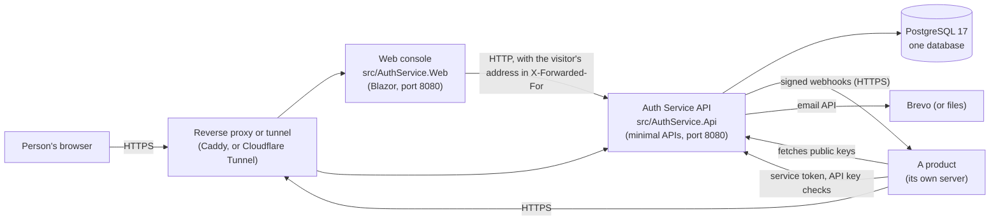

# Auth Service reference

A feature-by-feature technical and business reference for the Auth Service, written from the code (version 1.0.0). It has two readers:

- **A new developer** who has to maintain the service and needs to know what each feature is for, what rules it enforces and where it lives.
- **An on-call engineer** who has a production symptom and needs to get to the right code, table, setting or log line quickly.

Every file path, class, method, route, setting, table and column named in these files was checked to exist in the repository (see
"Keeping this accurate" at the end). Where a rule is not visible in the code, the text says **Assumption (confirm)** or **Unknown** so the owner
can confirm it. Those are collected at the end of each part. They are not facts.

## How to use it

| You want to... | Go to |
|---|---|
| Understand the system in ten minutes | "Architecture" and "Glossary" below |
| Learn how one feature works | the feature index below, then that part |
| Diagnose a production problem | "Symptom index" below, then the part it points to (each part ends with its own, longer, table) |
| Decide what to review or harden first | "Highest-risk areas" below |
| Find a setting | [07 Configuration reference](07-configuration-reference.md) |
| Deploy or update | [../deployment.md](../deployment.md) and [../release-checklist.md](../release-checklist.md) |
| Know why a big choice was made | [../decisions/](../decisions/README.md) (ADRs 0001 to 0009) |

Each part follows the same shape, per feature: **What it does** (business purpose and rules), **How it is implemented** (entry points, flow,
data), **Configuration and environment**, **Failure modes and production debugging**, **Decisions and open questions**.

## The parts

| # | Part | Features covered |
|---|---|---|
| 1 | [Accounts and sign-in](01-accounts-and-sign-in.md) | sign-up, email verification, login, login protection and lockout, refresh tokens, logout, current user, password reset, password policy, the identity access token |
| 2 | [Organisations, members and roles](02-organisations-members-and-roles.md) | organisations (tenants) and their status, memberships, invitations, roles and permissions by level, role assignment, the tenant permission catalog, member product access |
| 3 | [Products, subscriptions and webhooks](03-products-and-subscriptions.md) | platform admin, product registration and catalogs, product credentials and the service token, launch URL and "my products", subscriptions and seats, webhooks to products and secret overlap |
| 4 | [Tokens, keys and the authorization package](04-tokens-keys-and-the-authorization-package.md) | the three token kinds, token exchange, signing keys and the JWKS, API keys, the `AuthService.Authorization` package, the hand-off into a product, tenant isolation |
| 5 | [Platform and cross-cutting behaviour](05-platform-and-cross-cutting.md) | audit log, email delivery, rate limiting, client address and proxies, paging, health and metrics, error responses, authorization policies, database and background workers |
| 6 | [The web console](06-web-console.md) | how the console calls the API, the server-side session, public pages, the picker and hand-off, the tenant console, the platform console, security headers |
| 7 | [Configuration reference](07-configuration-reference.md) | every setting of the API and the console, with defaults and danger notes |

## Architecture

The Auth Service gives a set of separate **products** one sign-in and one permission model. A **person** has one identity and belongs to one or
more **organisations** (tenants). An organisation **subscribes** to products and decides, with roles, who may do what in each. A product never
stores passwords: it trusts a short-lived signed token and checks it locally.

| Part | Where | What it is |
|---|---|---|
| API | `src/AuthService.Api` | ASP.NET Core 10 minimal APIs. `Program.cs` registers everything. Each feature is a folder under `Features/` (`*Endpoints.cs` routes, `*Service.cs` logic). Shared parts: `Tokens/`, `Email/`, `RateLimiting/`, `Observability/`, `Common/`. |
| Data | `src/AuthService.Infrastructure` | EF Core with PostgreSQL. `Persistence/Entities`, `Configurations`, `Migrations`. Table and column names are snake_case. Migrations are applied explicitly, never on startup ([ADR 0003](../decisions/0003-migrations-applied-explicitly.md)). |
| Web console | `src/AuthService.Web` | A Blazor Web App that is only a client of the API. The signed-in session lives on the server ([ADR 0006](../decisions/0006-signed-in-session-kept-on-the-server.md)); the browser holds a cookie with an opaque session id. |
| Product package | `src/AuthService.Authorization` | The NuGet package a product installs to check tokens locally against the public keys. `samples/SampleProduct*` shows it in use. |
| Tests | `tests/AuthService.IntegrationTests`, `tests/AuthService.Web.Tests` | Integration tests run against a real PostgreSQL (Testcontainers). Folder and test names carry story codes (`Ten02`, `Tok01`, `AUTH_TC5_...`), so the tests are the most precise statement of the rules. |
| Deployment | `Dockerfile`, `deploy/` | Three images (API, web console, migration job); a compose stack with Caddy, or the tunnel variant. |

**One database, five background workers** (all in the API process): `EmailDispatcher` (sends queued email), `WebhookDispatcher` (delivers
webhooks to products), `SigningKeyWorker` (reloads and rotates signing keys), `AuditRetentionWorker` (deletes old audit rows),
`RateLimitCleanupWorker` (deletes expired counters). If one stops, its feature stops quietly; see part 5, "Database, migrations and background
workers".

### The three tokens

| | Identity token | Product token | Service token |
|---|---|---|---|
| Says | who a person is | who, in which one organisation, for which one product, with which permissions | which product is calling the Auth Service |
| Made by | login and refresh | token exchange (`POST /api/auth/token/exchange`) | `POST /api/auth/token` (client credentials) |
| Lifetime | 15 min | 15 min | 10 min |
| Checked by | the Auth Service | the product (with the package), or the Auth Service for its own tenant-admin endpoints | the Auth Service |

A **refresh token** (30 days, opaque, stored hashed) only gets a new identity token. Nothing is revoked early: an issued token stays valid until it
expires, which is why the lifetimes are short. Details and the comparison table are in part 4.

### What happens when a person opens a product

1. The person signs in at the console (part 6). The console calls `POST /api/auth/login`; the API returns an identity token and a refresh token, kept
   on the server in the session store.
2. The person picks an organisation and a product. The console asks `GET /api/auth/users/me/applications` which products that person may open there.
3. The console calls token exchange. The API checks the membership is active, the organisation is not suspended, the subscription is active and the
   person has a seat, works out the person's permissions from their roles, and signs a **product token** for that organisation and that product.
4. The console posts the product token in a form to the product's registered **launch URL** ([ADR 0007](../decisions/0007-hand-the-token-to-a-product-with-a-form-post.md)).
5. The product validates the token locally: signature (public keys from `/.well-known/jwks.json`), issuer, audience, expiry. It takes the tenant from
   the token only, and enforces permissions by level (`ReadOnly`, `CreateRead`, `Full`).
6. In the background, when an organisation subscribes or is suspended, the API queues a signed **webhook** to the product and a worker delivers it
   with retries.

### Deployment shapes

One Ubuntu server running Docker Compose (`deploy/docker-compose.yml`) is the documented shape: the web console, the API, PostgreSQL and a migration
job, behind either Caddy (Let's Encrypt certificates) or a Cloudflare Tunnel. See [../deployment.md](../deployment.md). The service is
designed so several API instances can share one database (key rotation, email, webhooks and rate limits all coordinate through it), but the web
console keeps its session in memory and so runs as one instance today (part 6).

## Glossary

| Term | Meaning |
|---|---|
| **Access level** | How much of a permission a person holds: `None`, `ReadOnly`, `CreateRead`, `Full`. A higher level includes the lower ones. |
| **Account / user / identity** | One global person record (`users`), the same in every organisation. Email is the login name. |
| **Admin API** | The `/api/auth/admin/*` endpoints, for platform admins only. |
| **API key** | A long-lived secret a tenant's own backend uses to call a product without a person signing in. Stored as a salted hash; shown once. |
| **Application** | The code and database name for a **product** (`applications` table, `Application` entity). |
| **Audience (`aud`)** | The product a token is for. A product accepts only its own. Registered per product as `JwtAudience`. |
| **Audit log** | Append-only record of important actions (`audit_entries`), read by platform admins and by an organisation's admins for their own organisation. |
| **Built-in product** | The Auth Service as a product of its own (audience `auth-service-tenant`), so organisation admins use the same permission model for the console ([ADR 0005](../decisions/0005-auth-service-as-its-own-product.md)). |
| **Catalog (permission catalog)** | The list of permission keys a product declares (`campaign.read`, ...). Roles grant them. |
| **Client credentials / service token** | A product's client id and secret, exchanged for a service token that identifies the product to the Auth Service. |
| **Console** | The web application people use: the organisation console and the platform console. |
| **Hand-off** | Sending a person into a product with a product token posted to its launch URL. |
| **Identity token** | Short-lived token proving who a person is, with no tenant and no audience. |
| **Invitation** | A link emailed to someone to join an organisation. Creates an `Invited` membership until accepted. |
| **JWKS** | The public keys the Auth Service publishes at `/.well-known/jwks.json` so products can check token signatures. |
| **Launch URL** | The https address a product registers for the hand-off. |
| **Membership** | A person's relationship to one organisation (`tenant_memberships`): `Invited`, `Active` or `Disabled`. |
| **Outbox** | A table where an email or webhook is written in the same transaction as the change that caused it, and a worker delivers it later (`email_outbox`, `webhook_outbox`). |
| **Owner** | The built-in role every organisation starts with. It holds `Full` on everything, cannot be edited or deleted, and an organisation always keeps one. |
| **Permission** | A named capability (`key`) of a product, granted by a role at an access level. |
| **Platform admin** | A person with `users.is_platform_admin` set (only by SQL). Runs the platform: products, signing keys, platform audit. |
| **Product** | A separate system that trusts the Auth Service for sign-in and permissions. |
| **Product token** | Short-lived token for one person, one organisation and one product, carrying `tid` and `permissions`. |
| **Refresh token** | A 30-day opaque secret that gets a new identity token; rotated on use; reuse revokes the whole family. |
| **Role** | A named set of permission grants in one organisation (`roles`, `role_permissions`), assigned to members. |
| **Seat** | One person's access to one product in one organisation (`application_access`). Subscriptions can limit seats (`max_seats`). |
| **Signing key** | The ES256 key pair the Auth Service signs tokens with, stored encrypted in the database, rotated on a schedule. |
| **Subscription** | An organisation's use of a product (`subscriptions`): `Active`, `Suspended` or `Cancelled`. Made by the product, not the organisation. |
| **Tenant** | An organisation. `tid` in a token is the tenant id. |
| **Token exchange** | Trading an identity token for a product token. |
| **Webhook** | A signed HTTPS call from the Auth Service to a product about a subscription change (`X-Auth-Signature: v1=<hex>`). |

## Feature index

| Feature | Part |
|---|---|
| Sign-up (account plus first organisation) | [1](01-accounts-and-sign-in.md) |
| Email verification and resend | [1](01-accounts-and-sign-in.md) |
| Login, lockout and the per-address limit | [1](01-accounts-and-sign-in.md) |
| Refresh tokens, logout, current user | [1](01-accounts-and-sign-in.md) |
| Password reset, password policy | [1](01-accounts-and-sign-in.md) |
| Organisations, tenant status and profile | [2](02-organisations-members-and-roles.md) |
| Members: states, enable and disable, the Owner rule | [2](02-organisations-members-and-roles.md) |
| Invitations | [2](02-organisations-members-and-roles.md) |
| Roles and permissions by level; assigning roles | [2](02-organisations-members-and-roles.md) |
| Product access (seats) for a member | [2](02-organisations-members-and-roles.md), [3](03-products-and-subscriptions.md) |
| Platform admin and the admin API | [3](03-products-and-subscriptions.md) |
| Product registration, catalogs, activation, launch URL | [3](03-products-and-subscriptions.md) |
| Product credentials, service token, secret rotation | [3](03-products-and-subscriptions.md) |
| Subscriptions and seat limits | [3](03-products-and-subscriptions.md) |
| Webhooks to products and secret overlap | [3](03-products-and-subscriptions.md) |
| Token exchange | [4](04-tokens-keys-and-the-authorization-package.md) |
| Signing keys, rotation and the JWKS | [4](04-tokens-keys-and-the-authorization-package.md) |
| API keys | [4](04-tokens-keys-and-the-authorization-package.md) |
| The authorization package and the sample product | [4](04-tokens-keys-and-the-authorization-package.md) |
| Tenant isolation | [4](04-tokens-keys-and-the-authorization-package.md) |
| Audit log | [5](05-platform-and-cross-cutting.md) |
| Email delivery | [5](05-platform-and-cross-cutting.md) |
| Rate limiting | [5](05-platform-and-cross-cutting.md) |
| Client address and reverse proxies | [5](05-platform-and-cross-cutting.md), [6](06-web-console.md) |
| Paging, error responses, authorization policies | [5](05-platform-and-cross-cutting.md) |
| Health, readiness and metrics | [5](05-platform-and-cross-cutting.md) |
| Database, migrations, background workers | [5](05-platform-and-cross-cutting.md) |
| Web console session and pages | [6](06-web-console.md) |
| The picker and the hand-off page | [6](06-web-console.md) |
| Tenant console and platform console | [6](06-web-console.md) |
| Security headers | [6](06-web-console.md) |
| Every setting | [7](07-configuration-reference.md) |

## Symptom index

The most common production symptoms, with the part that has the full diagnosis. Each part ends with a longer table for its own area.

| Symptom | Likely cause | Go to |
|---|---|---|
| Everyone gets 429 `rate_limited` on login, forgot or resend at once | The proxy is not listed in `Auth:Proxy`, so all visitors share one address | [5](05-platform-and-cross-cutting.md), [1](01-accounts-and-sign-in.md), [6](06-web-console.md) |
| Login, reset, resend, service token or token exchange answers 503 `rate_limit_unavailable` | The `rate_limit_counters` table is missing (migration not run) or the database is unreachable; rate limiting fails closed | [5](05-platform-and-cross-cutting.md) |
| `/health/ready` returns 503 | Database unreachable, a migration pending, or no signing key is current (`signingKey: failed`) | [5](05-platform-and-cross-cutting.md), [4](04-tokens-keys-and-the-authorization-package.md) |
| The API will not start | Missing or wrong `Auth:Tokens:KeyEncryptionKey`, bad database string, or a mistyped proxy, rate-limit or metrics setting | [4](04-tokens-keys-and-the-authorization-package.md), [7](07-configuration-reference.md) |
| Verification, reset or invitation email never arrives | Dispatcher off, provider misconfigured, a `Failed` row in `email_outbox`, or the Brevo sender is not verified | [5](05-platform-and-cross-cutting.md), [1](01-accounts-and-sign-in.md) |
| An email link opens a dead page or `localhost` | `Email:PublicBaseUrl` points at the wrong site (with Brevo the service will not start unless it is an absolute https address) | [5](05-platform-and-cross-cutting.md), [2](02-organisations-members-and-roles.md) |
| "Verification link invalid or expired" (410) | Link used or older than the token lifetime (the email states the configured lifetime) | [1](01-accounts-and-sign-in.md) |
| A user says "invalid credentials" with the right password | The account is locked (5 wrong passwords, 15 minutes), or the account has no password yet | [1](01-accounts-and-sign-in.md) |
| Users are repeatedly signed out | A refresh token reuse revokes the whole family; or the console restarted (sessions are in memory) | [1](01-accounts-and-sign-in.md), [6](06-web-console.md) |
| Everyone is signed out after a deploy | The console's session store is in memory | [6](06-web-console.md) |
| A product rejects every token (401) | Wrong audience, issuer or JWKS URL in the product's options; keys cannot be fetched | [4](04-tokens-keys-and-the-authorization-package.md) |
| A person lost (or kept) access after a role change | Product tokens last 15 minutes and the console caches its token; nothing is revoked early | [4](04-tokens-keys-and-the-authorization-package.md), [2](02-organisations-members-and-roles.md) |
| A person cannot open a product (403 `exchange_denied`) | No active subscription, no seat, disabled membership, or the product is inactive | [4](04-tokens-keys-and-the-authorization-package.md), [3](03-products-and-subscriptions.md) |
| A suspended organisation cannot open its console | Exchange refuses a suspended organisation; suspension is a manual database change | [2](02-organisations-members-and-roles.md) |
| A product is missing from the picker, or "isn't ready to open yet" | Product inactive, no subscription, or no launch URL | [3](03-products-and-subscriptions.md), [6](06-web-console.md) |
| Webhook stuck `Pending` or `Failed` | Dispatcher off, receiver down or redirecting, wrong key-encryption key, or deadline passed (24 h) | [3](03-products-and-subscriptions.md) |
| A product reports a bad webhook signature | Verifying over parsed JSON instead of the raw body, or the secret was rotated during the overlap | [3](03-products-and-subscriptions.md) |
| A product cannot get a service token (401 `invalid_client`) | Wrong or expired secret after a rotation | [3](03-products-and-subscriptions.md) |
| Seats "full" (409 `no_seat_available`) | Invited and disabled members count differently than expected; an unexpired invitation holds a seat, an expired one does not (AUTH-269) | [2](02-organisations-members-and-roles.md), [3](03-products-and-subscriptions.md) |
| An owner cannot be disabled | The organisation must keep an Owner (409 `last_owner`) | [2](02-organisations-members-and-roles.md) |
| Platform console says "You don't have access" to a real admin | `users.is_platform_admin` is not set; an admin 403 has no body | [3](03-products-and-subscriptions.md), [6](06-web-console.md) |
| Audit entries show the proxy's address | Forwarded headers not trusted from the proxy | [5](05-platform-and-cross-cutting.md) |
| A list shows only 50 rows | Lists are paged; the cursor must be followed | [5](05-platform-and-cross-cutting.md) |
| A secret (API key, product secret) was not shown | Shown once, held in the console's memory; a restart loses it | [6](06-web-console.md) |
| Blank page or "Rejoining the server..." | WebSocket blocked by a proxy | [6](06-web-console.md) |
| Tokens fail for a minute after a key rotation | Other instances and products reload keys on a timer | [4](04-tokens-keys-and-the-authorization-package.md) |
| Database growing without bound | No cleanup for tokens and finished outbox rows | [5](05-platform-and-cross-cutting.md), [1](01-accounts-and-sign-in.md) |

## Highest-risk areas

Review these first, most risky first. Each links to the part that explains it. They come from the parts' own risk lists, combined and ordered.

1. **One secret protects the signing keys and the webhook secrets** (`Auth:Tokens:KeyEncryptionKey`). Losing it, or running instances with
   different values, makes stored keys unreadable and the service will not start. Re-encryption is not built. Back it up apart from the database.
   Parts [4](04-tokens-keys-and-the-authorization-package.md), [5](05-platform-and-cross-cutting.md), [3](03-products-and-subscriptions.md).
2. **All of the web console's state is in one process's memory.** Sessions, the cached console tokens and one-time secrets vanish on restart, and a
   second copy would break sign-in. A secret the API created but the console lost cannot be recovered. Part [6](06-web-console.md).
3. **Proxy and forwarded-address trust.** A wrong setting either puts every visitor in one rate-limit bucket (a sign-in outage) or lets a visitor
   choose their address. Both the API (`Auth:Proxy`) and the console (`AuthService:Proxy`) must be right. Parts [5](05-platform-and-cross-cutting.md),
   [6](06-web-console.md), [1](01-accounts-and-sign-in.md).
4. **Nothing is revoked early, so changes reach products late.** A suspension, a removed seat or a role downgrade takes up to 15 minutes (plus the
   console's cache) to take effect. Tenant suspension itself is now an audited admin action that is checked on every tenant-admin call (AUTH-268). Parts
   [4](04-tokens-keys-and-the-authorization-package.md), [2](02-organisations-members-and-roles.md), [3](03-products-and-subscriptions.md).
5. **Signing-key lifecycle has no self-repair.** If no key is signing (the worker was down past a key's end, or rows are inconsistent), login and
   exchange fail and nothing fixes it. An emergency rotation is instant only on the instance that handled it. Part [4](04-tokens-keys-and-the-authorization-package.md).
6. **Rate limiting fails closed on the database.** A missed migration or a database fault turns five core endpoints into 503. Deploy order
   (migrate first) matters. Part [5](05-platform-and-cross-cutting.md).
7. **Tenant isolation rests on hand-written `tenant_id` conditions.** There is no global query filter or row-level security, so one new query that
   omits the condition is a data leak. Review every new tenant-scoped endpoint against the isolation tests (`Tok04`). Part [4](04-tokens-keys-and-the-authorization-package.md).
8. **Email is the only path to a working account, and its failures are silent.** A stopped dispatcher, a `Failed` row, a bounce, the default
   `Email:PublicBaseUrl` pointing at the wrong site. Parts
   [5](05-platform-and-cross-cutting.md), [1](01-accounts-and-sign-in.md), [2](02-organisations-members-and-roles.md).
9. **Webhooks are the only way a product learns of a subscription change.** One worker per instance, at-least-once, a database transaction held open
   across the HTTP call, no cleanup of old rows, and the webhook address is a server-side-request-forgery surface that depends on
   `Auth:Webhooks:AllowPrivateAddresses` staying off. Part [3](03-products-and-subscriptions.md).
10. **Refresh-token rotation under concurrency.** A duplicate request or a lost response revokes the whole family, including the newest token, and the
    "reuse detected" audit entry is also written for ordinary logout and reset. Part [1](01-accounts-and-sign-in.md).
11. **Organisation rules enforced only in code, with gaps.** Unaccepted invitations can now be withdrawn and expire out of the seat count (AUTH-269), but the "tenant keeps an Owner" rule has no
    database constraint. Part [2](02-organisations-members-and-roles.md).
12. **Unbounded growth (mostly fixed).** The cleanup (AUTH-270) removes finished tokens, outbox rows and expired product secrets after a
    retention; it and audit retention can still be switched off, and expired invitations are kept on purpose. Parts [1](01-accounts-and-sign-in.md), [5](05-platform-and-cross-cutting.md), [3](03-products-and-subscriptions.md).
13. **The platform admin flag is an unaudited database column** that gates everything, including signing-key rotation. Part [3](03-products-and-subscriptions.md).
14. **Browser-side exposure in the console:** a live product token carried through the browser in the hand-off form (a nonce `script-src` policy now blocks injected scripts, AUTH-271),
    and a possible sign-in redirect loop if the API rejects a token the console still thinks is fresh. Part [6](06-web-console.md).
15. **The audit log's append-only protection is a database trigger the application's own database user could drop.** Use a restricted role if the
    log is a compliance record. Part [5](05-platform-and-cross-cutting.md).

## Inconsistencies found while documenting

These were found by reading the code. They are not fixed here; each is in its part with the detail. They are listed so the owner can decide.
Four earlier findings were fixed afterwards (AUTH-266): a password reset now verifies the email; the email text states the configured lifetime;
the Brevo provider needs an https `Email:PublicBaseUrl`; and only an active Owner can change an Owner's status in either direction.

- `Email:PublicBaseUrl` defaults to `http://localhost:5080`, the API's development port (the console is on 5090); only the Brevo provider checks it (part 5).
- Admin and tenant authorization failures answer 403 with an empty body and no `code`; the API's other errors use `ApiProblem` (parts 3, 5).
- On subscribe, the tenant Owners are given access without a seat-limit check, so seats used can exceed `max_seats` (part 3).
- Token exchange and service-token issue write neither a log line nor an audit entry (parts 3, 4).
- Logout and forgot-password write no audit entry; lists built with `PageQuery` reject a lone `before`, but the audit and webhook lists accept it (parts 1, 5).
- No component in the web console sets a render mode, so every page is static, though [ADR 0002](../decisions/0002-blazor-web-app-for-ui.md) says the console is interactive.
  `UserSession` is a record whose generated `ToString()` prints the session id, though its comment says the id is never printed (part 6).
- `TenantStatus.Trial` and `AuditActorType.ApiKey` exist but nothing sets them; `AuditLabels` has no label for `auth.application.launch_url_set` (parts 2, 5, 6).
- `docs/deployment.md` and the README have been corrected or flagged where they disagreed with the code (see the commit that added this reference).

## Keeping this accurate

- Change a feature, change its section in the same pull request. The sections name classes and methods, not line numbers, so they survive
  ordinary edits.
- `node docs/reference/verify-reference.js` checks that every file path, class, method, route, setting, table and column cited in these files still
  exists in the repository, and that the links between the parts work. Run it after renaming or moving code. A few reported items are expected:
  names that belong to the .NET framework (`HasQueryFilter`), generated assets, and the gitignored `deploy/.env`.
- When something here turns out to be wrong, fix the file and say in the commit what the code actually does.
